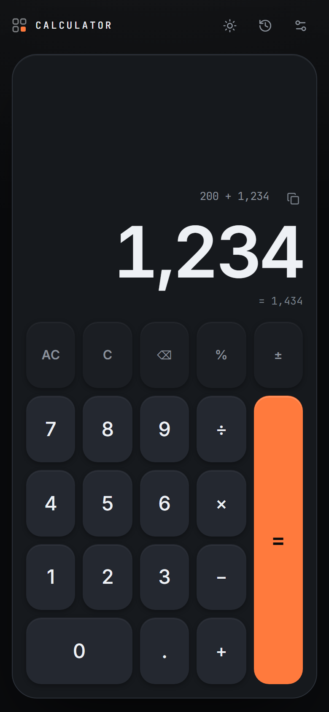
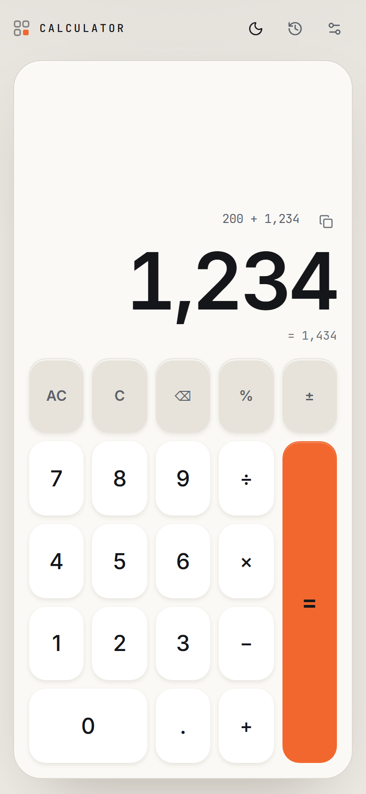
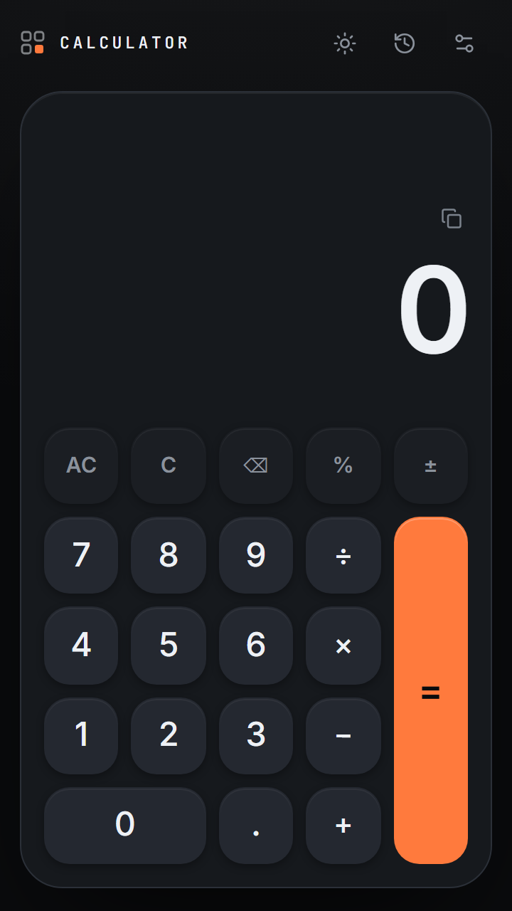

<div align="center">

# Calculator

**A premium, tactile calculator that behaves like a carefully designed physical device.**

Dark-first · Offline-capable · Installable · Correct to the last digit

[](https://react.dev)
[](https://www.typescriptlang.org)
[](https://vite.dev)
[](https://tailwindcss.com)
[](https://developer.mozilla.org/en-US/docs/Web/Progressive_web_apps)
[](https://www.python.org)
[](LICENSE)

</div>

<div align="center">

| Dark | Light | Phone |
| :---: | :---: | :---: |
|  |  |  |

</div>

---

## Table of contents

- [What it is](#what-it-is)
- [Features](#features)
- [Quick start](#quick-start)
- [Android app](#android-app)
- [Google Play release](#google-play-release)
- [The calculation engine](#the-calculation-engine)
- [The Python reference engine](#the-python-reference-engine)
- [Haptics — what is real and what is not](#haptics--what-is-real-and-what-is-not)
- [Design system](#design-system)
- [Responsive behaviour](#responsive-behaviour)
- [Accessibility](#accessibility)
- [Privacy](#privacy)
- [Project structure](#project-structure)
- [Verification](#verification)
- [Contributing](#contributing)
- [License](#license)

---

## What it is

A single-screen calculator built around three ideas:

1. **Correctness before cleverness.** The calculation engine is a pure, token-based state machine with an explicit grammar — never `eval()`, never regular-expression arithmetic. It is cross-validated against an independent Python reference engine.
2. **Tactility.** Every key answers immediately: a press-scale response, a distinct haptic pattern per interaction class, an optional synthesised click, and a deliberate visual state for the pending operator.
3. **Restraint.** One accent colour, one typeface family for text and another for numerals, no gradients, no glass, no glow. The interface gets out of the way of the arithmetic.

---

## Features

| Area | Behaviour |
| --- | --- |
| **Display** | Small monospace expression line, large tabular-numeral value, live `=` preview, copy-to-clipboard with confirmation. The value scales itself down using container-query units, so long numbers never overflow. |
| **Keypad** | 21 keys in a five-column grid. `0` spans two columns; `=` spans four rows as a full-height signal-orange bar. The pending operator lights up. |
| **Arithmetic** | `+ − × ÷` with correct precedence, decimals, negatives, percentages, repeated `=`, backspace, clear entry, clear all, division-by-zero handling. |
| **History** | The last 50 calculations, stored on the device. Tap an entry to reuse its result; delete one entry or clear the lot. |
| **Keyboard** | `0`–`9`, `+ - * /`, `.`, `Enter`/`=` (equals), `Backspace` (delete), `Escape`/`Delete` (clear), `C` (clear entry), `%`, `~`/`n` (sign). |
| **Feedback** | Vibration patterns for digits / operators / equals / clear / error, plus an optional Web Audio click. Both are independently switchable. |
| **Appearance** | Dark (default), light, or follow the system. Theme transitions are colour-only. |
| **Motion** | Every animation is under 300 ms, transform/opacity only, and fully disabled by `prefers-reduced-motion` or the in-app switch. |
| **PWA** | Installable, works offline via a precaching service worker, self-hosted fonts. Nothing leaves the device. |

---

## Quick start

**Requirements:** Node.js ≥ 20 and Python ≥ 3.10.

```bash
# 1. Install dependencies
npm install

# 2. Start the development server
npm run dev            # → http://localhost:5173
```

### Scripts

| Command | Description |
| --- | --- |
| `npm run dev` | Start the Vite development server |
| `npm run build` | Type-check and produce a production build in `dist/` |
| `npm run build:android` | Production build for Android (no service worker) |
| `npm run preview` | Serve the production build locally |
| `npm run typecheck` | `tsc -b` — full type check |
| `npm run lint` | `oxlint` — lint the source |
| `npm run test:python` | pytest — unit, fixture and differential tests |
| `npm run test:ui` | Playwright — 7 viewports, full interaction pass |
| `npm run test:pwa` | Playwright — manifest, service worker, offline |
| `npm run verify:fixtures` | Run the frontend engine against the shared fixture |
| `npm run assets` | Regenerate every icon, splash screen and store graphic |
| `npm run cap:sync` | Build for Android and copy the web assets into the native project |
| `npm run android:apk` | Build the signed, installable APK |
| `npm run android:aab` | Build the signed Android App Bundle for Play |
| `npm run android:open` | Open the native project in Android Studio |
| `npm run signing:key` | Create the Android release key (outside the repo) |

### Python tooling

```bash
python -m pip install -r python/requirements.txt
npm run test:python      # or: python -m pytest python -v
```

The UI and PWA checks drive a real browser and expect a server to be running:

```bash
npm run dev              # then, in another shell: npm run test:ui
npm run preview          # then, in another shell: npm run test:pwa
```

---

## Android app

The same codebase ships as a native Android application through **Capacitor 8**.
There is no second implementation: the Android app is the web build, bundled
inside the APK/AAB, rendered by the system WebView.

| | |
| --- | --- |
| Application ID | `com.imtty.calculator` |
| Version | `1.0.0` (version code `1`) |
| Target SDK | 36 (Android 16) |
| Minimum SDK | 24 (Android 7.0) — covers Android 8.0 and newer |
| Size | ~1.5 MB installed |
| Permissions | `VIBRATE` (haptics) and `INTERNET` (WebView runtime only) |

### Building it

```bash
npm run cap:sync        # build the web app for Android + copy it in
npm run android:apk     # signed APK  -> android/app/build/outputs/apk/release/
npm run android:aab     # signed AAB  -> android/app/build/outputs/bundle/release/
npm run android:open    # open the project in Android Studio
```

> **Note:** `cap:sync` rebuilds `dist/` in *Android* mode, so after running it
> the `dist/` folder holds the Android bundle (no service worker) rather than
> the web build. Run `npm run build` again before `npm run preview` if you want
> to serve the web version.

The Android build (`vite build --mode android`) **disables the service
worker on purpose** — the native app already contains every file, so a second
caching layer in front of the bundled assets would only add risk.

### Native features

| Feature | Implementation |
| --- | --- |
| Haptics | `@capacitor/haptics` — `ImpactStyle.Light` for digits, `Medium` for operators, `Heavy` for clear, `Success` for equals, `Error` for errors. On the web it falls back to the Vibration API. |
| Status bar | `@capacitor/status-bar` — the bar colour and the icon contrast follow the app theme, and the WebView is inset below it. |
| Splash screen | `@capacitor/splash-screen` — a graphite launch screen with the app mark and wordmark, generated by `scripts/generate_assets.py`. |
| Back button | `@capacitor/app` — closes an open panel first, then walks the web history, and only exits when there is nowhere left to go. |

### Release signing

The signing key lives **outside** the repository:

```
C:\Users\LENOVO\.pulse-calc-signing\calculator-release.jks
C:\Users\LENOVO\.pulse-calc-signing\SIGNING-CREDENTIALS.txt
```

Gradle reads the credentials from `android/keystore.properties`, which is
git-ignored. If that file is missing the release build simply stays unsigned,
so a fresh clone can still produce a debug APK.

To create the key on a new machine:

```bash
npm run signing:key
```

> **Back the key up.** If you lose it, you can never update the app on
> Google Play again — you would have to publish a new listing.

---

## Google Play release

Everything needed to submit is prepared in this repository.

```
release/
  calculator-release.aab     <- upload this to Google Play Console
  calculator-test.apk        <- install this on your phone
  PLAY_STORE_GUIDE.md        <- step-by-step publishing instructions
  RELEASE_CHECKLIST.md       <- tick this off before uploading
  PRIVACY_AND_DATA_SAFETY.md <- exact answers for the Data safety form

store-assets/
  icon/icon-512.png                        512 x 512 Play icon
  feature-graphic/feature-graphic-1024x500.png
  screenshots/01..06-*.png                  real 1080 x 1920 phone captures
  short-description.txt  full-description.txt
  release-notes.txt     category.txt  keywords.txt

privacy-policy.html                        publish this on a public HTTPS page
```

The `.aab` and `.apk` are build outputs and are not kept in git. Rebuild
them with `npm run android:aab` and `npm run android:apk`.

Start with **`release/PLAY_STORE_GUIDE.md`** — it walks through creating the
developer account, filling in the listing, publishing the privacy policy,
answering the declarations and submitting for review, in plain language.

> **Note on new personal developer accounts.** If your Play developer account
> was created after 13 November 2023 and is a *personal* account, Google
> requires you to run a closed test with **at least 12 testers opted in
> continuously for 14 days** before you can apply for production. Start that
> clock as soon as the account exists — it is the longest part of the process.

---

## The calculation engine

### Architecture

```
src/engine/
  formatter.ts          number cleaning + display formatting
  expressionParser.ts   recursive-descent parser / evaluator
  calculatorEngine.ts   the pure reducer + display derivation
  keyDefinitions.ts     keypad layout, labels and feedback mapping
```

The engine has no React, no DOM and no timers. Every transition is
`(state, action) -> state`, which is why it can be executed directly by Node
for the differential tests.

### Token model

An expression is a list of tokens, never a string:

```ts
type Token =
  | { kind: 'number'; value: number; raw: string }
  | { kind: 'operator'; op: '+' | '-' | '*' | '/' }
  | { kind: 'percent' }
```

The *entry* — the raw text currently being typed — is kept separate from the
committed token list. That distinction is what makes `0.50` echo back as
`0.50`, makes backspace predictable, and makes a trailing operator a normal
state rather than a special case.

### Percentage semantics

`%` is a postfix operator whose meaning depends on the operator in front of
its operand:

| Expression | Meaning | Result |
| --- | --- | --- |
| `200 + 10%` | 10 % **of the accumulated value** | `220` |
| `200 − 10%` | 10 % of the accumulated value | `180` |
| `200 × 10%` | 10 % of 100 | `20` |
| `10%` | 10 % of 100 | `0.1` |

In the parser this is the `percentBase` / `percentBaseValue` pair threaded
through `parseExpression` → `parseTerm` → `parseFactor`. The base applies only
to the **first** factor of a term, so `200 + 3 × 10%` resolves the `10%`
against 100 (it follows `×`), not against 200.

### Repeated equals

`=` replays the last binary operation:

| Keys | Result |
| --- | --- |
| `2 + 3 =` | `5` |
| `2 + 3 = =` | `8` |
| `1 + 2 × 3 = =` | `21` — the *multiplication* repeats, because `×` was the last operator pressed |
| `200 + 10% = =` | `242` — the percentage is re-scaled against the new base |

### Numeric precision

The browser computes with IEEE-754 doubles. Two rules keep the display clean:

1. **Integers are never rounded.** Every integer a double can represent exactly stays exact.
2. **Non-integers are cleaned to 12 significant digits**, which removes binary noise: `0.1 + 0.2` displays as `0.3`, `1 ÷ 3` as `0.333333333333`.

Magnitudes outside `[1e-6, 1e21)` switch to exponential notation (`1e−7`,
`1e+21`); everything else is grouped with thousands separators and uses a
typographic minus sign (`−`).

### Division by zero

`5 ÷ 0` reports **Cannot divide by zero** immediately, both while typing and
on `=`. The expression is discarded and the next key press starts a fresh
calculation.

---

## The Python reference engine

`python/reference_engine.py` is an independent implementation of the same
specification using `decimal.Decimal` instead of doubles, so precision
sensitive cases are checked against exact arithmetic.

```
python/
  reference_engine.py        the engine (Decimal-based)
  test_reference_engine.py   pytest suite
  fixtures/calculator_cases.json   the shared behaviour contract
  requirements.txt
```

### The shared fixture

`python/fixtures/calculator_cases.json` holds ~40 cases, each a list of key
presses and the expected display. Both engines are driven by it:

```json
{
  "id": "percent-additive",
  "keys": ["2", "0", "0", "+", "1", "0", "%", "="],
  "expected": { "expression": "200 + 10% =", "value": "220", "preview": null, "error": null }
}
```

Because the key vocabulary (`0`–`9`, `+ - × ÷ . % ± AC C ⌫ =`) matches the real
keypad, the fixture exercises the shipping code path, not a parallel
implementation.

### Three layers of testing

| Layer | What it proves |
| --- | --- |
| Unit tests | The arithmetic and formatting rules in isolation. |
| Fixture tests | The Python engine matches every expected display. |
| Differential tests | The **real frontend engine** matches every expected display, *and* matches the Python engine case by case. |

The differential test runs the TypeScript engine directly in Node using its
built-in type stripping (Node ≥ 22.18) — no extra tooling:

```bash
npm run verify:fixtures    # prints the frontend engine's results as JSON
```

---

## Haptics — what is real and what is not

The app uses the **Vibration API** (`navigator.vibrate`).

**Honest limitations:**

- The API accepts a duration in milliseconds, or an array of durations and
  pauses. It has **no intensity control** — the browser decides how strong a
  pulse feels. Any claim of controlling vibration strength on the web is
  inaccurate.
- **iOS Safari does not implement the Vibration API at all.** On iPhone and
  iPad the app falls back to the visual press feedback and, if enabled, the
  sound cue. The settings panel states this when support is missing.
- Some browsers define `navigator.vibrate` but throw when it is called
  outside a user gesture. The implementation probes conservatively and
  swallows failures.
- Haptics are fired synchronously inside the user gesture, after the
  calculation has already been performed — a vibration can never delay a
  result.

### Patterns

| Interaction | Pattern (ms) |
| --- | --- |
| Digit, decimal point | `8` |
| Operator, percentage, sign | `14` |
| Equals | `[14, 40, 16]` — a double tap that reads as "confirmed" |
| Clear / backspace | `[10, 35, 10]` |
| Error | `[45, 60, 45]` |

The optional sound is synthesised with the Web Audio API — a short pitched
blip plus a 4 ms band-passed noise transient — so it works offline and needs
no assets.

---

## Design system

### Colour

One accent, used once. Everything else is a neutral surface.

| Token | Dark | Light |
| --- | --- | --- |
| `--pc-bg` | `#0a0b0d` | `#edeae4` |
| `--pc-surface` | `#16191d` | `#fbf9f5` |
| `--pc-key` | `#242830` | `#ffffff` |
| `--pc-key-fn` | `#1b1e23` | `#e7e3da` |
| `--pc-accent` | `#ff7a3d` | `#f2672e` |
| `--pc-accent-contrast` | `#0a0b0d` | `#14161a` |
| `--pc-text` | `#eef1f5` | `#14161a` |
| `--pc-text-muted` | `#8b929c` | `#5a6069` |
| `--pc-danger` | `#ff6b60` | `#d1341f` |

All text/background pairs meet WCAG AA (≥ 4.5:1) for body text and ≥ 3:1 for
large text and UI boundaries.

### Typography

- **Inter Variable** — interface text and the large value, with
  `font-variant-numeric: tabular-nums` so digits never reflow.
- **JetBrains Mono Variable** — the expression line and the wordmark. The
  mono/sans contrast is deliberate: the mono line is what you *typed*, the
  sans figure is what you *got*.

Both are self-hosted through `@fontsource-variable`, so they work offline and
no third-party request is ever made.

### Motion

| Element | Duration | Easing |
| --- | --- | --- |
| Key press | 120 ms | `cubic-bezier(0.23, 1, 0.32, 1)` |
| Copy confirmation | 220 ms | same |
| Panel / drawer | 220–260 ms | `cubic-bezier(0.32, 0.72, 0, 1)` |
| Theme crossfade | 260 ms | colour properties only |

Press feedback is a CSS transition on `transform` and `background-color` only
— no layout properties, so nothing reflows and the compositor keeps the
animation on the GPU. Digit entry is deliberately **not** animated: it happens
hundreds of times a day, and an animation there reads as lag.

---

## Responsive behaviour

| Range | Layout |
| --- | --- |
| `< 768px` | Full-height device surface. The keypad absorbs the leftover height; the display keeps a bottom-aligned value. Safe-area insets are honoured; the page never scrolls. |
| `≥ 768px` | The calculator takes a deliberate fixed size (412 px wide) and is centred — never stretched. A keyboard-shortcut hint appears beneath it. |
| `≥ 768px` panels | History and settings open as a right-hand drawer. |
| `< 768px` panels | History and settings open as a bottom sheet. |

Additional mobile details: `100dvh` app shell, `overscroll-behavior: none`,
`-webkit-tap-highlight-color: transparent`, `touch-action: manipulation`,
`user-select: none` on controls only, `viewport-fit=cover`, and a
`theme-color` per colour scheme.

---

## Accessibility

- Every control is a real `<button>` with an accessible name.
- The display is an `<output>` with `aria-live="polite"`, so the current value
  is announced as it changes.
- Touch targets are verified to be **≥ 44 × 44 CSS px** in the automated UI
  checks — including the settings switches, whose visible track is 44 × 26 px
  but whose hit area is 62 × 44 px.
- Visible focus rings (`2px` outline, offset) — focus is never removed.
- The keypad is fully keyboard-operable; `Tab` reaches every key.
- `prefers-reduced-motion` is respected, and can be forced on from settings.
- The pending operator is exposed with `aria-pressed`.
- Colour is never the only signal: the operator state, the error state and
  the copy confirmation all carry text or shape as well.

---

## Privacy

The app collects nothing and sends nothing. There is no account, no server,
no database, no analytics and no advertising.

- Calculations are computed **on the device**.
- Settings and the last 50 calculations are stored in the device's own local
  storage and are never transmitted.
- The Android build **disables Android cloud backup and device transfer**, so
  even the operating system does not copy that data elsewhere.
- The app requests **no runtime permissions**.
- The production bundle was scanned for outbound URLs: none exist. Fonts,
  icons and every asset are bundled inside the app.

The full policy is in [`privacy-policy.html`](privacy-policy.html) — publish
that file on a public HTTPS page for Google Play, and find it inside the app
under **Settings → About → Privacy policy**. See
[`release/PRIVACY_AND_DATA_SAFETY.md`](release/PRIVACY_AND_DATA_SAFETY.md) for
the exact Data safety form answers and the dependency-by-dependency audit.

---

## Project structure

```
.
├── index.html
├── capacitor.config.ts          Capacitor configuration (app id, plugins)
├── vite.config.ts               Vite + Tailwind v4 + vite-plugin-pwa
├── privacy-policy.html          standalone privacy policy page
├── public/
│   ├── icons/                   web / PWA icons
│   └── splash/                  splash artwork
├── docs/                        screenshots used by this README
├── scripts/
│   ├── generate_assets.py       every brand, launcher and store asset
│   ├── create_signing_key.py    creates the Android release key (outside the repo)
│   ├── capture_screenshots.py   captures the real Play Store screenshots
│   ├── verify-fixtures.mjs      runs the frontend engine against the fixture
│   ├── ui_check.py              Playwright UI verification
│   └── pwa_check.py             Playwright PWA + offline verification
├── python/
│   ├── reference_engine.py      Decimal-based reference implementation
│   ├── test_reference_engine.py pytest suite (unit + fixture + differential)
│   ├── fixtures/calculator_cases.json
│   └── requirements.txt
├── android/                     native Android project (Capacitor)
│   ├── app/build.gradle         release signing, R8 shrinking
│   └── app/src/main/res/        launcher icons and splash screens
├── release/                     Play Store upload bundle and guides
├── store-assets/                Google Play listing graphics and copy
└── src/
    ├── App.tsx                  application shell
    ├── main.tsx
    ├── components/
    │   ├── Calculator/           Calculator, Display, Keypad, CalculatorButton
    │   ├── History/HistoryPanel.tsx
    │   ├── Privacy/PrivacyPolicySheet.tsx
    │   ├── Settings/            SettingsPanel, Toggle
    │   ├── TopBar.tsx
    │   └── ui/                  IconButton, Sheet
    ├── engine/                  the pure calculator core
    │   ├── calculatorEngine.ts  reducer + display derivation
    │   ├── expressionParser.ts  parser / evaluator
    │   ├── formatter.ts         number cleaning + formatting
    │   └── keyDefinitions.ts    keypad layout, labels, feedback mapping
    ├── hooks/                   useCalculator, useHaptics, useSound,
    │                            useKeyboard, useHistory, useMediaQuery,
    │                            useNativePlatform, settingsContext,
    │                            SettingsProvider
    ├── styles/                  globals.css, tokens.css
    ├── types/calculator.ts
    └── utils/                   storage, cn
```

> The `src/engine/` and `src/types/` modules import with explicit `.ts`
> extensions so that Node can execute the engine directly with its built-in
> type stripping. That is what makes the differential test possible without
> adding a test runner or a bundler step.

---

## Verification

| Check | Command | Result |
| --- | --- | --- |
| Types | `npm run typecheck` | clean, no errors |
| Lint | `npm run lint` | clean, no warnings |
| Python suite | `npm run test:python` | **163 passed** |
| Frontend engine vs. fixture | `npm run verify:fixtures` | matches the fixture exactly |
| Build | `npm run build` | succeeds; the service worker precaches the built assets |
| UI + interaction | `npm run test:ui` | all checks pass at 7 viewports |
| PWA + offline | `npm run test:pwa` | manifest, icons, service worker and offline all pass |
| Android bundle | `npm run android:aab` | signed `.aab` produced, JAR signature verified |
| Android APK | `npm run android:apk` | signed `.apk` produced, v2 signature verified |
| Bundle audit | — | no development-server URLs, no outbound endpoints |

`scripts/ui_check.py` drives a real Chromium browser and verifies: no console
errors or warnings, no horizontal overflow, ≥ 44 px touch targets, a fully
visible keypad, the calculation flow (percentages, repeated equals,
division-by-zero, recovery), long-value overflow, the full keyboard map, theme
switching, history record/reuse, every settings control, switch knob geometry
(inside the track, exact 3 px insets, animated rather than jumping),
accessible names, live-region announcements, keyboard reachability, and Escape
dismissing an open panel — at 360 px, 390 px, 393 px, 430 px, 834 px, 1440 px
and 1920 px.

`scripts/pwa_check.py` runs against the production build and verifies the
manifest (name, icons, maskable icon, every icon resolving), service worker
registration, and that the app still renders *and calculates* with the network
switched off.

### Dependency audit

`npm audit` reports **4 low-severity advisories**, all in the *build-time*
dependency chain `vite-plugin-pwa → workbox-build → @rollup/plugin-node-resolve`
and rooted in `deepmerge@4.3.1` (GHSA-gcqx-w48m-w2h4, prototype poisoning in
`mergeObject()`). **No patched `deepmerge` release exists yet** — the advisory
range still includes the latest version — and the only "fix" npm can offer is
downgrading `vite-plugin-pwa` to `0.2.1`, which is incompatible with Vite 8.

None of this code ships: it runs only during `npm run build` and none of it
reaches the browser bundle. The eight moderate-severity advisories that the
chain originally carried (`minimatch`, `glob`, `ejs`) were resolved with the
`overrides` block in `package.json`, and the build, the service worker and the
offline behaviour were re-verified afterwards.

### Not verified

**Physical-device testing has not been performed** — no Android handset was
available during the build. The following still need a real phone:

- The **feel** of the haptic patterns (that digits, operators, equals and
  errors are distinguishable by touch).
- The **launch screen** and **adaptive launcher icon** as rendered by the
  device launcher.
- Behaviour in **airplane mode** after a full restart.
- The **Android back button** and the status bar in both themes.
- Behaviour on a **small screen** (5-inch) and a **tablet**.

`release/RELEASE_CHECKLIST.md` lists every device check so none is missed.
The release is signed and installable, but treat section B of that checklist
as the gate before uploading to Play.

---

## Contributing

Issues and pull requests are welcome.

1. **Keep the engine pure.** `src/engine/` must stay free of React, the DOM
   and timers — that is what makes the differential tests possible.
2. **Add a fixture case** for any behaviour change and run
   `npm run test:python`. The frontend and the Python reference engine must
   agree.
3. **Run the full check** before opening a pull request:
   `npm run typecheck && npm run lint && npm run test:python && npm run build`.
4. **Keep motion restrained.** Animations belong to state changes, not to
   decoration, and must respect `prefers-reduced-motion`.

---

## License

Released under the [MIT License](LICENSE).

---

<div align="center">
Made with care — every digit checked.
</div>
